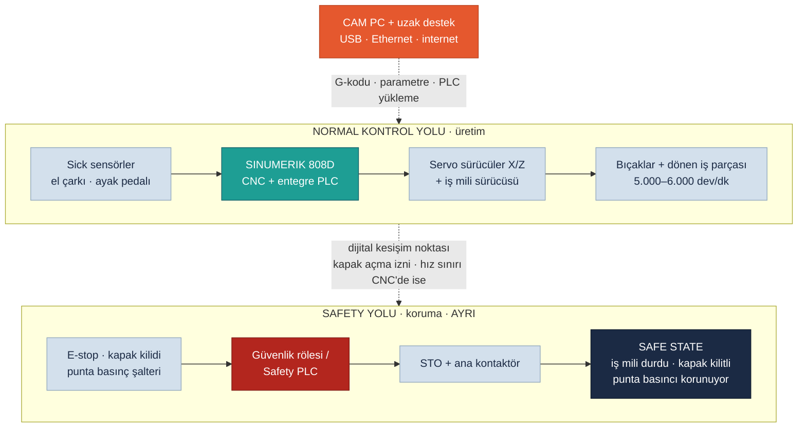

<!-- pdf:skip-start -->
# Lab 1 · Safety Architecture

**Makine:** Schnitzer 2 Eksen 2 Ünite CNC Ahşap Torna · **Çıktı:** Safety Function Map → Evidence Pack **EP 03 Safety Functions** · 📄 [PDF föyü](pdf/lab1-safety-architecture.pdf)

| Ad Soyad | Öğrenci No | Grup | Tarih |
|---|---|---|---|
| Yusuf Kaymaz | 230541084 | Gündüz-B | 23.10.2026 |
<!-- pdf:skip-end -->

> **Schnitzer bağlamı:** 5.000–6.000 dev/dk dönen ahşap iş parçası ve 75 m/dk hızla hareket eden bıçak taşıyıcı el, kol ve kıyafet için ciddi tehlikedir. Koruma zinciri: **E-stop + kapak kilidi + punta basınç kontrolü → güvenlik rölesi / Safety PLC → STO + ana kontaktör**. Programlar USB ve Ethernet ile yükleniyor, üretici desteği uzaktan veriliyor. Sorular bu **dijital kesişim noktasına** gidecek.

## Safety Function Map

Kırmızı kutu (Safety PLC / güvenlik rölesi) ve alttaki yol, **safety-related control system (SRCS)**'dir. Turuncu kutu, dışarıdan erişilebilen dijital kapıdır. Kesikli çizgiler, siber müdahalenin emniyet zincirine dokunabildiği yerleri gösterir.

## Görev — sırayla cevaplayın

### 1. Bu makinede tehlike nedir? İnsan neyden zarar görür?

- **Dönen iş parçası (5.000–6.000 dev/dk):** kol, eldiven, saç veya kıyafet dolanır (yakalanma). Ağır ve kalıcı yaralanma.
- **Bıçaklar ve bıçak taşıyıcı:** V-bıçak ve çanak bıçakla kesilme. Taşıyıcı 75 m/dk hızla hareket ettiği için çarpma ve ezilme.
- **Fırlayan parça:** punta sıkması gevşerse, kütük çatlak/budaklıysa veya hız parçaya göre fazlaysa iş parçası ya da kopan parçası fırlar. Yüze, göze ve vücuda çarpma.
- **Pnömatik merkezleme ve punta:** ayak pedalıyla kapanırken parmak sıkışması.
- **İkincil:** ahşap tozu (solunum, yangın), gürültü.

Operatör en çok **parça yüklerken veya alırken**, ölçü kontrolünde ve talaş temizliğinde, yani kapak açıkken tehlikeye yaklaşır.

### 2. Safety function (emniyet fonksiyonu) hangisidir?

| ID | Emniyet fonksiyonu | Önlediği tehlike |
|---|---|---|
| SF-1 | **Acil durdurma (E-stop):** basılınca iş mili ve eksenlerin enerjisi kesilir | Tüm tehlikeler (tamamlayıcı koruma) |
| SF-2 | **Kapak kilidi:** kapak açıkken iş mili ve eksenler çalışamaz, iş mili tamamen durmadan kapak açılamaz | Dolanma, kesilme, çarpma |
| SF-3 | **Punta basınç izleme:** sıkma basıncı yetersizse iş mili başlamaz veya durdurulur | Parça fırlaması |
| SF-4 | **İş mili azami hız sınırı:** parça çapına uygun hız aşılamaz | Parçanın çatlayıp fırlaması |

Ana fonksiyon **SF-2**: operatör kapağı her parçada açtığı için hem en sık erişim hem de en ağır sonuç buradadır.

### 3. Safety-related control system nerede? Şemada işaretleyin.

Şemadaki alttaki ayrı yol: **E-stop + kapak kilidi + punta basınç şalteri (giriş) → güvenlik rölesi / Safety PLC (mantık) → STO + ana kontaktör (çıkış)**. SINUMERIK 808D'nin entegre PLC'si, CAM PC ve uzak destek bu sistemin parçası **değildir**. Ancak kapak açma izni veya hız sınırı CNC'de hesaplanıyorsa (VS-3), o kısım fiilen emniyet zincirine dahil olur ve korunmasız kalır.

### 4. CNC kontrolör (SINUMERIK 808D – entegre PLC) ile güvenlik rölesi / Safety PLC farkı nedir? `UYARLANDI`

808D'nin entegre PLC'si **üretimi** yönetir: G-kodunu işler, eksenleri ve iş milini sürer, M-kodlarıyla pnömatiği açıp kapatır. Emniyet sınıfı (PL/SIL) sertifikası yoktur, tek kanallıdır, USB ve Ethernet üzerinden programlanabilir ve parametreleri değiştirilebilir. Güvenlik rölesi / Safety PLC ise **sertifikalıdır** (PL d/e), çift kanallı çalışır, kendini ve kablolamayı sürekli test eder, arıza görünce makineyi güvenli duruma alır ve yalnızca emniyet fonksiyonunu yürütür. Kısaca: üst yol üretim için, alt yol hayat için.

### 5. PLr / SIL neden var? Bu fonksiyon için neden önemli?

PLr/SIL, bir emniyet fonksiyonunun riske göre **ne kadar güvenilir** olması gerektiğini belirler. Kapak kilidi (SF-2) için: **şiddet S2** (dolanma ağır ve kalıcı yaralanma yapar), **sıklık F2** (operatör her parçada kapağı açar), **kaçınma P2** (5.000 dev/dk'da kaçmak neredeyse imkânsız). ISO 13849-1 risk grafiğinde bu yol **PLr e**'ye çıkar. Bu güvenilirlik güvenlik rölesinin / Safety PLC'nin konfigürasyonuna bağlıdır: konfigürasyon değişirse performans da değişir.

### 6. Safe state (güvenli durum) nedir?

Güvenli durum bağlama bağlıdır. Bu tornada:

- İş mili ve eksenler **durmuş**, sürücülerin enerjisi STO ile kesilmiş;
- Kapak, iş mili **tamamen durana kadar kilitli**;
- Punta **basıncı korunuyor**. Parça hâlâ dönerken sıkma bırakılırsa parça fırlar, yani pnömatikte güvenli durum "enerjiyi kes" değil "konumu koru"dur;
- Makine, kapak kapanıp reset verilmeden kendiliğinden yeniden çalışmaz.

### 7. Safety function hangi dijital bağımlılıklara sahip?

- 808D entegre PLC programı (kapak açma izni ve punta basınç kontrolü burada ise)
- Makine parametreleri (iş mili azami hızı, eksen hız ve ivme sınırları)
- G-kodu programı (S = iş mili hızı, F = ilerleme, koordinatlar)
- Servo ve iş mili sürücülerinin parametreleri ve firmware'i
- Güvenlik rölesi / Safety PLC konfigürasyonu (programlanabilir tipse)
- Üreticinin CAM yazılımı ve CAM PC (G-kodunu üretir)
- Yükleme yolları: USB portu, Ethernet, uzak destek bağlantısı

### 8. Siber müdahale hangi noktadan bu fonksiyonu bozar?

**Dijital kesişim noktası:** CNC'ye (808D) program, parametre veya PLC yazılabilen yol, yani USB portu, Ethernet ve CAM PC üzerindeki uzak destek bağlantısı. Buradan iş mili hız sınırı yükseltilebilir (SF-4). Kapak açma izni CNC'de ise kapak dönen parçada açılabilir (SF-2), punta basınç kontrolü de atlanabilir (SF-3). En riskli yol: **internete açık uzak destek → CAM PC → Ethernet → 808D**.

## Ek sorularımız

### 9. STO devreye girince dönen iş parçası hemen durur mu? Bu neden önemli? `EK SORU`

Hayır. STO yalnızca motora giden torku keser (IEC 60204-1 durma kategorisi 0). 4 kW'lık iş mili ve ahşap kütük, fren yoksa ataletle **saniyelerce dönmeye devam eder**. Bu süre operatörün kapağı açıp elini uzatma süresinden uzunsa kapak kilidi yalnızca "kapak kapalı" bilgisine değil, **iş milinin gerçekten durduğunun doğrulanmasına** bağlı olmalıdır. Diğer seçenek: önce kontrollü frenleme, sonra STO (SS1).

### 10. G-kodu programı neden emniyetle ilgilidir? `EK SORU`

G-kodu bir emniyet fonksiyonu değildir ama emniyet fonksiyonlarına **yük bindirir**: S komutu iş mili hızını, F ilerlemeyi, koordinatlar bıçağın nereye gideceğini belirler. Parça çapına göre fazla hız kütüğü çatlatıp fırlatabilir, yanlış koordinat bıçağı puntaya çarptırabilir. Bu yüzden hız sınırı (SF-4) programdan ve CNC parametresinden **bağımsız** olmalı, programlar çalıştırılmadan önce 3D önizleme ve kuru çalıştırma ile kontrol edilmelidir.

## Varsayımlar

VS-1, VS-2 ve VS-3 bu föyde kullanıldı (bkz. [Makine Profili](00-makine-profili.md#varsayımlar-sahada--üreticiden-doğrulanacak)). Kapak kilidinin tipi ve güvenlik rölesi mimarisi sahada doğrulanacak.

---

Bu föyün çıktısı **Safety Function Map** → Evidence Pack **EP 03 Safety Functions** başlığına oturur. Durum: **Taslak**.

*SAFETY 4.0 BOOTCAMP · Schnitzer CNC Ahşap Torna Sürümü · Bu bir eğitim çıktısıdır, resmî denetim değildir.*
