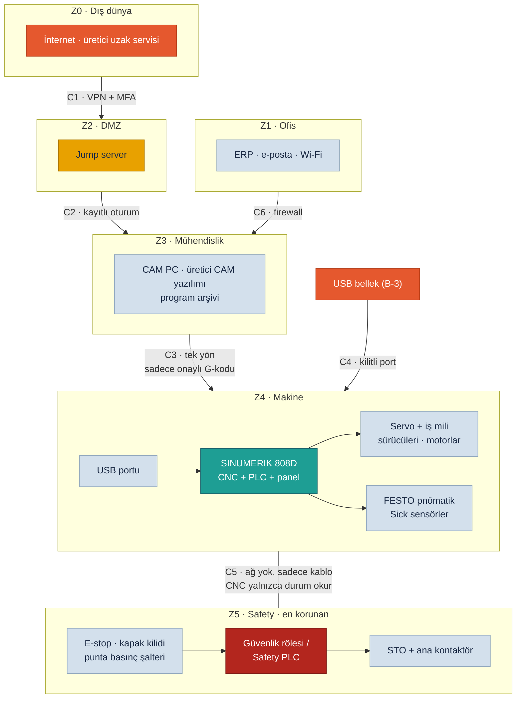

<!-- pdf:skip-start -->
# Lab 2 · IEC 62443 Mini Workshop

**Makine:** Schnitzer 2 Eksen 2 Ünite CNC Ahşap Torna · **Çıktı:** Zone / Conduit Diagram → Evidence Pack **EP 01 Asset Inventory + EP 05 Zone & Conduit** · 📄 [PDF föyü](pdf/lab2-iec62443-zone-conduit.pdf)

| Ad Soyad | Öğrenci No | Grup | Tarih |
|---|---|---|---|
| Yusuf Kaymaz | 230541084 | Gündüz-B | 23.10.2026 |
<!-- pdf:skip-end -->

> **Kavram:** Zone = benzer kritiklikteki cihazları bir bölgeye topla. Conduit = bölgeler arası her geçişe kontrollü bir kapı. 62443'ün maddesini ezberlemiyoruz, mantığını uyguluyoruz.

## Görev A — varlıkları bölgelere ayırın

### Varlık listesi — saldırı yüzeyi altı kategoriyle `UYARLANDI`

Föyde hazır bir liste yoktu. Bu makinenin listesini ders yöntemine göre **altı kategoriyle** biz çıkardık. İlk bakışta "bir makine, bir CNC" görünüyor; sistematik sayımla **28 kalem ve 3 dış bağlantı** çıktı.

| Kategori | Varlıklar / kapılar |
|---|---|
| **1 · Donanım** | D-1 SINUMERIK 808D (CNC + entegre PLC + kumanda paneli) · D-2 servo sürücüler X/Z + servo motorlar · D-3 iş mili sürücüsü + 4 kW motor · D-4 FESTO valf adası, merkezleme, punta + basınç şalteri · D-5 Sick sensörler · D-6 el çarkı + ayak pedalı · D-7 E-stop, kapak kilidi, güvenlik rölesi / Safety PLC, ana kontaktör · D-8 CAM PC · D-9 Ethernet bağlantısı / switch · D-10 CNC ön panel USB portu |
| **2 · Yazılım / firmware** | Y-1 808D sistem yazılımı · Y-2 808D PLC programı (kapak, pnömatik mantığı) · Y-3 makine parametreleri (hız sınırları) · Y-4 sürücü firmware + parametreleri · Y-5 üreticinin CAM yazılımı · Y-6 CAM PC işletim sistemi + uzak masaüstü yazılımı · Y-7 G-kodu programları |
| **3 · Hesaplar** | H-1 CNC erişim seviyeleri (üretici / servis / kullanıcı parolası, varsayılan olabilir) · H-2 CAM PC ortak operatör hesabı · H-3 uzak destek hesabı |
| **4 · Sertifika / anahtar** | K-1 paylaşılan uzak destek parolası · K-2 fabrika ağı / Wi-Fi parolası |
| **5 · Dış bağlantı** | B-1 uzak destek bağlantısı (internet → CAM PC) · B-2 CAM PC'nin internet çıkışı · B-3 USB bellek (elle taşınan bağlantı) |
| **6 · Kritik veri akışı** | V-1 G-kodu: CAM PC → USB/Ethernet → CNC · V-2 parametre / PLC yedek arşivi · V-3 üreticiden gelen güncelleme dosyaları |

### 1. Hangi varlıklar aynı bölgede? Bölgeleri adlandırıp gruplandırın.

| Zone | Varlıklar | Kritiklik |
|---|---|---|
| **Z0 · Dış dünya** | İnternet, üretici uzak servisi | Güvenilmez |
| **Z1 · Ofis** | Fabrika ofis ağı, ERP / e-posta, Wi-Fi | Düşük |
| **Z2 · DMZ** | Uzak erişim için jump server (hedef mimaride) | Tampon |
| **Z3 · Mühendislik** | CAM PC, üretici CAM yazılımı, program arşivi | Orta |
| **Z4 · Makine** | SINUMERIK 808D (CNC + PLC + panel), servo ve iş mili sürücüleri, motorlar, FESTO pnömatik, Sick sensörler, el çarkı / pedal, USB portu | Yüksek |
| **Z5 · Safety** | E-stop, kapak kilidi, punta basınç şalteri, güvenlik rölesi / Safety PLC, STO hattı, ana kontaktör | **En yüksek** |

Hesaplar ve parolalar ayrı bir bölge değildir, bağlı oldukları cihazın kapısıdır: H-1 Z4'ün, H-2 Z3'ün, H-3 ve K-1 Z2'nin kapısıdır.

### 2. Güvenlik rölesi / STO zincirini hangi bölgeye koydunuz? 808D'nin entegre PLC'si bu bölgeye girebilir mi? Neden? `UYARLANDI`

Ayrı ve en korunan **Z5 Safety Zone**'a koyduk. Bu bölgenin ağ bağlantısı yok, sinyaller kabloyla (hardwired) gelir. 808D'nin entegre PLC'si bu bölgeye **giremez**: emniyet sınıfı değildir ve USB/Ethernet ile programlanabilir. Bölge içi güvenilir sayıldığı için CNC'yi ele geçiren kişi safety zincirine de ulaşırdı. CNC, safety'den sadece durum bilgisi okur (kapak kapalı mı, E-stop basılı mı), safety kararlarını değiştiremez.

### 3. Bölgeler arası geçişler (conduit) nerede? Her geçişte ne kontrol edilecek?

| Conduit | Geçiş | Kontrol |
|---|---|---|
| **C1** | İnternet (üretici) → DMZ | Firewall'da sadece VPN, MFA, kişisel hesap, varsayılan kapalı erişim, oturum kaydı |
| **C2** | DMZ → Mühendislik (CAM PC) | Sadece jump server'dan, sadece gerekli protokol, oturum kaydı |
| **C3** | Mühendislik → Makine (Ethernet → 808D) | Tek yön, sadece onaylı G-kodu dosyası. Parametre ve PLC yazma kapalı, sadece CAM PC'nin adresine izin |
| **C4** | USB portu → Makine | Port kilidi, sadece kayıtlı ve taranmış USB. Program 3D önizleme ve kuru çalıştırmadan geçmeden üretime alınmaz |
| **C5** | Safety → Makine | Ağ yok, sadece kablo. CNC durum bilgisini okur, safety ayarı yalnızca yerinde, yetkili kişiyle ve kayıtla değişir |
| **C6** | Ofis → Mühendislik | Firewall, ofisten CNC'ye doğrudan yol yok. CAM PC'de e-posta ve web kullanılmaz |

## Görev B — uzak erişim kararı (6 satır)

| Karar | Seçenekler | Seçimimiz + nedeni |
|---|---|---|
| **Aracı?** | Doğrudan / Jump server | **Jump server:** üretici servisi CAM PC'ye ve 808D'ye doğrudan bağlanmaz, tek kontrollü giriş olur |
| **Tünel?** | Açık / VPN | **VPN:** Bursa'daki servis ile fabrika arasındaki trafik şifreli, dinlenemez ve araya girilemez |
| **Kimlik?** | Parola / MFA | **MFA:** paylaşılan uzak destek parolası çalınsa da tek başına yetmez |
| **Hesap?** | Paylaşılan / Kişisel | **Kişisel:** her teknisyene ayrı hesap, kim hangi parametreyi değiştirdi bilinir |
| **Kayıt?** | Yok / Tam oturum kaydı | **Tam oturum kaydı:** program veya parametre değişirse kanıt olur (Makine Tüzüğü Ek III 1.1.9: müdahale kanıtı) |
| **Zamanlama?** | Sürekli açık / Varsayılan kapalı | **Varsayılan kapalı:** sadece iş emriyle ve bakım süresince açılır, makine üretimdeyken uzaktan yazma yapılmaz |

## Çıktı — Zone / Conduit Diagram

## Ek sorularımız

### 4. USB portu bir conduit midir? Neden? `EK SORU`

Evet. Ağ kablosu olmasa da Makine Zone'a dışarıdan veri sokan bir geçiştir. G-kodu, parametre arşivi ve zararlı yazılım bu yoldan girebilir. Kontrolsüz USB, kontrolsüz bir conduit demektir. Bu yüzden diyagramda **C4** olarak işaretledik ve kilitli port + kayıtlı USB kuralı koyduk.

### 5. Bu makinede en riskli conduit hangisi? `EK SORU`

**C1 + C3 birlikte.** Uzak erişim (C1) internete açılan tek kapıdır. Bugünkü durumda (VS-4) CAM PC hem internete hem Ethernet ile CNC'ye bağlı olduğundan C3 köprü görevi görür: internetten giren kişi iki adımda iş mili hız sınırına ulaşır. Hedef mimaride bu köprüyü C3'teki "tek yön, sadece onaylı G-kodu" kuralı kırar.

## Varsayımlar

VS-2, VS-4, VS-5 ve VS-6 bu föyde kullanıldı (bkz. [Makine Profili](00-makine-profili.md)).

---

Bu föyün çıktısı **Zone / Conduit Diagram** → Evidence Pack **EP 05 Zone & Conduit** başlığına, varlık listesi de **EP 01 Asset Inventory** başlığına oturur. Durum: **Taslak**.

*SAFETY 4.0 BOOTCAMP · Schnitzer CNC Ahşap Torna Sürümü · Bu bir eğitim çıktısıdır, resmî denetim değildir.*
