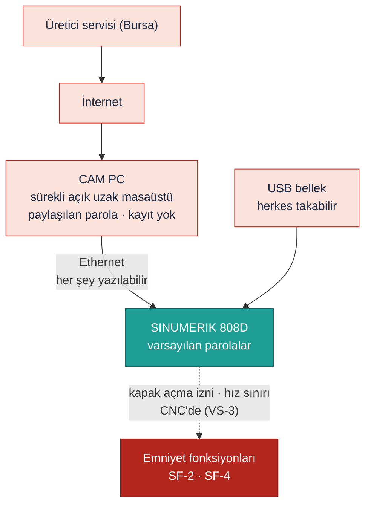
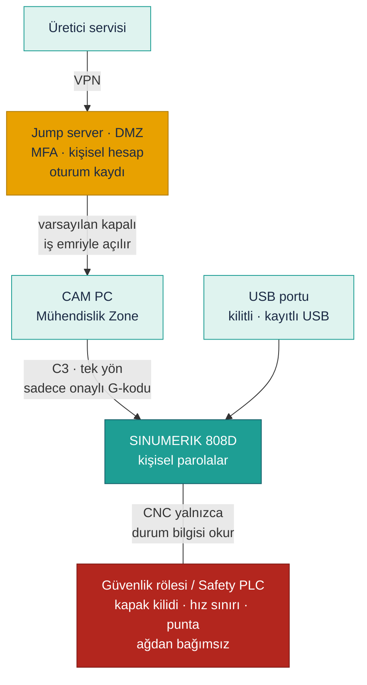

<!-- pdf:skip-start -->
# Lab 4 · Secure Remote Access

**Makine:** Schnitzer 2 Eksen 2 Ünite CNC Ahşap Torna · **Çıktı:** Secure Architecture → Evidence Pack **EP 02 Network Architecture + EP 06 Remote Access Procedure** · 📄 [PDF föyü](pdf/lab4-secure-remote-access.pdf)

| Ad Soyad | Öğrenci No | Grup | Tarih |
|---|---|---|---|
| Yusuf Kaymaz | 230541084 | Gündüz-B | 23.10.2026 |
<!-- pdf:skip-end -->

> **Kavram:** İki katman, ikisi de şart: **erişim güvenliği** (girişi zorlaştır: ara nokta, VPN, MFA, kişisel hesap, kayıt, varsayılan kapalı) + **emniyet bağımsızlığı** (girse bile insan korunur).

## Görev A — mevcut → hedef

### MEVCUT (savunmasız — kötü durum varsayımı VS-4, VS-6)

- Uzak destek yazılımı CAM PC'de sürekli açık, internetten doğrudan erişilebilir
- Teknisyenler ve operatörler aynı parolayı kullanıyor, MFA yok
- Erişim süresiz, fabrikadan onay alınmıyor
- Oturum kaydı yok: kim hangi programı veya parametreyi değiştirdi bilinmiyor
- CAM PC Ethernet ile CNC'ye doğrudan bağlı: PC'yi ele geçiren CNC'ye program ve parametre yazabiliyor
- USB portu açık, CNC erişim parolaları fabrika varsayılanı
- Kapak açma izni ve hız sınırı CNC'de, yani emniyet **bağımsız değil**

### HEDEF (beş ilkeyle yeniden tasarım)

- **1 · Ara nokta:** üretici yalnızca DMZ'deki jump server üzerinden gelir. CAM PC ve 808D internete doğrudan açık değil
- **2 · Kişisel hesap:** her teknisyene ayrı hesap. CNC'nin varsayılan parolaları değişir, operatör / servis / üretici seviyeleri ayrılır
- **3 · MFA:** uzak girişte parola + ikinci faktör zorunlu
- **4 · Varsayılan kapalı, süre sınırlı:** erişimi fabrikadaki sorumlu iş emriyle açar, bakım bitince otomatik kapanır. Makine üretimdeyken uzaktan yazma yapılmaz
- **5 · Oturum kaydı:** kim, ne zaman, hangi dosya veya parametre. Değişiklik öncesi ve sonrası CNC arşiv yedeği alınır
- **Ek kural:** Ethernet'te (C3) yalnızca onaylı G-kodu tek yönde geçer, USB portu kilitlidir (C4)

## Görev B — functional safety köprüsü

### 1. Saldırgan tüm önlemlere rağmen içeri girerse: emniyet fonksiyonu etkilenir mi? Neden?

Fonksiyona bağlı. E-stop ve STO zinciri kablolu güvenlik rölesindeyse (VS-2) **E-stop etkilenmez**. Ama kapak açma izni ve iş mili hız sınırı 808D'nin PLC'sinde ve parametrelerinde ise (VS-3) **etkilenir**: CNC'ye ulaşan saldırgan hız sınırını yükseltebilir veya kapağın dönen parçada açılmasına izin verebilir. Erişim güvenliği girişi zorlaştırır ama tek başına yetmez; dijital kesişim noktası bir saldırı yolu bırakır.

### 2. Kapak kilidi ve iş mili hız sınırının CNC'den ve uzak destek yolundan etkilenmemesi için GEREKSİNİMİ yazın (çözümü değil). `UYARLANDI`

- **GR-1:** E-stop, kapak kilidi ve punta basınç kontrolü, CNC'nin standart PLC'sinden bağımsız, emniyet sınıfı bir kontrol zincirinde yürümeli. USB, Ethernet ve uzak destek yolundan okunabilir ama **değiştirilemez** olmalı.
- **GR-2:** Kapak kilidi, iş milinin durduğu emniyet sınıfında doğrulanmadan açılmamalı. CNC'nin "durdu" bilgisine güvenilmemeli.
- **GR-3:** İş milinin azami hızı, G-kodu ve CNC parametresinden bağımsız bir emniyet fonksiyonuyla sınırlanmalı.
- **GR-4:** Enerji kesildiğinde punta sıkması konumunu korumalı; parça dönerken bırakılmamalı.
- **GR-5:** Emniyet konfigürasyonundaki her değişiklik yalnızca makine başında ve yetkili kişiyle yapılmalı, kayda geçmeli ve ardından safety validation (kapak, E-stop, punta testleri) yapılmalı.

*Tarafsızlık notu: Bu föy çözüm tasarlatmaz, gereksinimi tanımlatır. Hangi ürünle karşılanacağı firmanın kararıdır.*

## Ek sorumuz

### 3. Saldırı zincirini hangi halkada kırıyoruz? `EK SORU`

| Halka | Bu makinede | Kırma önlemi |
|---|---|---|
| **Keşif** | İnternette açık uzak destek görünür | Dışa açık hiçbir şey bırakma (jump server) |
| **İlk erişim** | Paylaşılan parolayla CAM PC'ye giriş | MFA + varsayılan kapalı |
| **Yerleşme** | Kalıcı uzak erişim veya yeni hesap | Kişisel hesap + oturum kaydı + hesap denetimi |
| **Yanal hareket** | CAM PC → Ethernet → 808D | C3: tek yön, sadece onaylı G-kodu |
| **Etki** | Hız sınırı veya kapak mantığı değişir | Emniyet bağımsızlığı (GR-1 … GR-5) |

Erişim önlemleri ilk dört halkayı, emniyet bağımsızlığı son halkayı kırar. Biri kemer, biri askı: ikisi de şart. Lab 3'teki R-01 bu sayede 27'den 2'ye iner.

---

Bu föyün çıktısı **Secure Architecture** → Evidence Pack **EP 02 Network Architecture + EP 06 Remote Access Procedure** başlığına oturur. Durum: **Taslak**.

*SAFETY 4.0 BOOTCAMP · Schnitzer CNC Ahşap Torna Sürümü · Bu bir eğitim çıktısıdır, resmî denetim değildir.*
