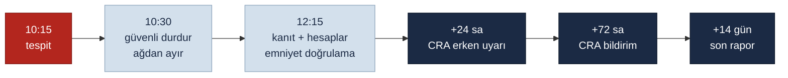

<!-- pdf:skip-start -->
# Lab 6 · CRA Incident Simulation

**Makine:** Schnitzer 2 Eksen 2 Ünite CNC Ahşap Torna · **Çıktı:** Incident Workflow → Evidence Pack **EP 13 Incident Response** · 📄 [PDF föyü](pdf/lab6-cra-incident-simulation.pdf)

| Ad Soyad | Öğrenci No | Grup | Tarih |
|---|---|---|---|
| Yusuf Kaymaz | 230541084 | Gündüz-B | 06.11.2026 |
<!-- pdf:skip-end -->

> **Senaryo `UYARLANDI`:** Saat 10:15. CAM PC'deki uzak destek hesabına (H-3) gece 03:00'te tanınmayan bir konumdan girilmiş. Oturumda CNC'ye (808D) Ethernet üzerinden bir parametre arşivi gönderilmiş olabilir. **İş mili hız sınırı ve kapak kilidi ayarları henüz doğrulanmadı.** Makine çalışıyor, operatör parça yüklüyor. Vardiya sorumlusu sizsiniz.

> **Kavram:** Bir olayda en değerli iki şey zaman ve kanıttır. CRA'nın 24 sa / 72 sa / 14 gün yükümlülükleri, iyi bir müdahale akışının doğal kilometre taşlarıdır, ezber değil. Bu olay, Lab 3'teki **R-01** senaryosunun gerçekleşmesidir.

## Incident Workflow — zaman çizgisi

## Görev — zaman çizgisini doldurun

### 1. 10:15 — ilk 15 dk: Kimi ararsınız? İlk üç eyleminiz?

**Kimi ararım:** üretim müdürü (karar yetkisi), İSG / safety sorumlusu, OT-IT sorumlusu ve **Schnitzer servisi**. Servisi bilinen telefon numarasından ararım, ele geçirilmiş uzak destek kanalından değil.

**İlk üç eylem:**

- **Güvenli durdurma:** çalışan program bitirilir veya besleme durdurulur, iş mili durur, operatör makineden uzaklaştırılır. Hız sınırı ve kapak ayarı doğrulanmadığı için makine **çalışmaya devam edemez.** Reset atılmaz, enerji kesilmez
- **Ağdan ayırma:** CAM PC'nin internet kablosu ve CNC'nin Ethernet kablosu çıkarılır. Cihazlar **kapatılmaz**, açık kalır ki bellekteki iz kaybolmasın
- **Kayıt başlatma:** olay kaydı açılır. Saat, kim neyi gördü, ekranların fotoğrafı. Makineye "kullanılmaz — olay incelemesi" etiketi asılır

### 2. İlk 2 saat: Emniyet güvende mi? Neyi korursunuz (kanıt)? Hangi hesap kapatılır? `UYARLANDI`

**Emniyet güvende mi?** Makine durdurulduğu için insan şu an güvende, ama emniyet fonksiyonları doğrulanmadan **yeniden çalıştırılmaz.** Doğrulama sırası:

- CNC'nin mevcut ("bulunduğu gibi") arşivi alınır, son bilinen sağlam arşivle karşılaştırılır (Lab 5 fark kontrolü)
- Hız sınırı (SF-4) ve kapak mantığı (SF-2) değerleri tek tek kontrol edilir
- Kablolu E-stop ve STO zinciri (SF-1) test edilir

**Korunan kanıt:**

- CNC'nin bulunduğu gibi arşivi, yeni ve temiz bir USB'ye alınır, özet değeri (hash) kaydedilir
- CNC alarm ve olay geçmişi
- CAM PC: uzak masaüstü bağlantı kayıtları, Windows olay günlükleri, mümkünse disk imajı
- Modem / firewall kayıtları (03:00 girişinin IP adresi)

**Kapatılan hesaplar:** uzak destek hesabı (H-3) ve paylaşılan parolası (K-1) devre dışı bırakılır. CAM PC'nin ortak operatör hesabının (H-2) parolası kanıt alındıktan sonra değiştirilir.

### 3. 24 saat — CRA erken uyarı: Hangi bilgi hazır olmalı?

- **Ne oldu:** uzak destek hesabıyla yetkisiz erişim, gece 03:00, CNC'ye parametre gönderilmiş olabilir
- **Hangi ürün:** Schnitzer 2 Eksen 2 Ünite, seri numarası, CNC sürümü (Lab 5, VS-7)
- **Aktif istismar şüphesi var mı:** evet, kötü niyetli erişim varsayılıyor
- **Yayılma riski:** aynı uzak destek parolası başka müşterilerin makinelerinde de kullanılıyorsa olay tek fabrikayla sınırlı değildir. Bu sorunun cevabı Schnitzer'den istenir
- **İlk önlemler:** makine durduruldu, ağdan ayrıldı, hesap kapatıldı

### 4. 72 saat — CRA bildirim: Kök neden, etki, önlem — kim ne yapıyor?

| Konu | İçerik | Kim (RACI) |
|---|---|---|
| **Kök neden** | Sürekli açık uzak masaüstü, paylaşılan parola, MFA yok, kayıt yok (Lab 4 MEVCUT) | R: OT-IT · C: Schnitzer |
| **Etki** | Hangi parametreler değişti (arşiv farkı), emniyet fonksiyonu etkilendi mi, yaralanma var mı, üretim kaybı | R: Safety + OT · C: Üretim |
| **Önlem** | Hesap kapatıldı, makine ağdan ayrıldı, sağlam arşiv geri yüklenecek, Lab 4 hedef mimariye geçiş | R: OT-IT + Schnitzer |
| **Bildirim** | CRA bildirimini üretici olarak Schnitzer yapar, fabrika gereken bilgileri sağlar | A: Yönetim · R: Schnitzer |

### 5. 14 gün — son rapor: Hangi loglar / kayıtlar korunmuş olmalı?

- Uzak erişim bağlantı kayıtları ve modem / firewall kayıtları
- CAM PC olay günlükleri ve disk imajı
- CNC alarm geçmişi, bulunduğu gibi arşiv ve sağlam arşiv (hash değerleriyle)
- Arşiv farkı: hangi parametre, eski değer → yeni değer
- Yeniden başlatma öncesi safety validation test kayıtları (EP 15)
- Olay zaman çizelgesi ve iletişim kaydı: kim kime ne zaman haber verdi

**Ders:** kayıtlar 7 gün tutuluyorsa 14 günlük rapor için kanıt kalmaz. Bu yüzden yeni gereksinim: **uzak erişim ve güvenlik duvarı kayıtları en az 90 gün saklanır.**

> **En sık hata:** "Resetleyip devam edelim." O düğme kanıtı sonsuza dek siler. Önce emniyet, hemen sonra kanıt.

## Ek sorularımız

### 6. Makineyi yeniden çalıştırmak için hangi koşullar sağlanmalı? `EK SORU`

| # | Koşul | Kanıt |
|---|---|---|
| 1 | Kanıtlar alındı ve hash değerleri kaydedildi | Olay kaydı |
| 2 | Son bilinen sağlam arşiv geri yüklendi, fark incelendi | Arşiv farkı |
| 3 | SF-1 … SF-4 fonksiyon testleri geçti | İmzalı test formu (EP 15) |
| 4 | Uzak destek hesabı kapalı, paylaşılan parola iptal | Hesap listesi |
| 5 | Uzak erişim kapalı kalır veya Lab 4 hedef mimariyle açılır | Ağ şeması (EP 02) |
| 6 | Safety sorumlusu ve üretim müdürü yazılı onay verdi | İmza |

Biri bile eksikse makine çalışmaz.

### 7. CRA bildirimi kimin yükümlülüğü: bizim mi, Schnitzer'in mi? `EK SORU`

CRA'nın bildirim yükümlülüğü **ürünün üreticisindedir.** Schnitzer, aktif olarak istismar edilen bir zafiyeti veya ürünün güvenliğini etkileyen ciddi bir olayı ENISA'nın tek raporlama platformu üzerinden yetkili CSIRT'e bildirir. Bu yükümlülük 11 Eylül 2026'dan beri geçerli. Son raporun süresi olayın türüne göre değişir: zafiyette düzeltici önlem çıktıktan sonra 14 gün, ciddi olayda bildirimden sonra 1 ay. Fabrika olarak bizim görevimiz üreticiye **hemen** haber vermek ve kanıtı sağlamaktır. Gönüllü olarak ulusal CERT'e (USOM) de bilgi verebiliriz. Ders: kimin bildireceği olaydan önce, sözleşmede ve EP 13'te yazılı olmalı.

---

Bu föyün çıktısı **Incident Workflow** → Evidence Pack **EP 13 Incident Response** başlığına oturur. Durum: **Taslak**.

*SAFETY 4.0 BOOTCAMP · Schnitzer CNC Ahşap Torna Sürümü · Bu bir eğitim çıktısıdır, resmî denetim değildir.*
