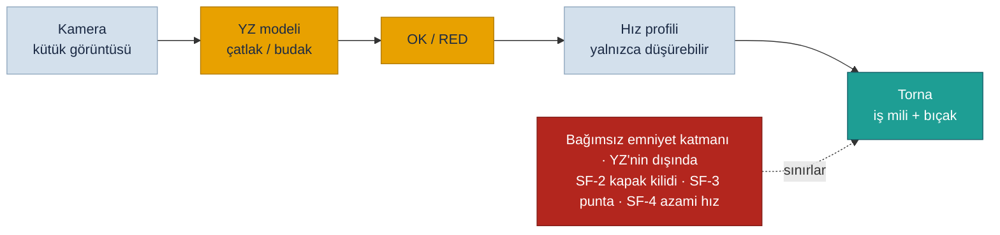

<!-- pdf:skip-start -->
# Lab 7 · AI Safety Challenge

**Makine:** Schnitzer 2 Eksen 2 Ünite CNC Ahşap Torna · **Çıktı:** AI Fail-Safe Decision → Evidence Pack **EP 03 Safety Functions + EP 15 Verification/Test** · 📄 [PDF föyü](pdf/lab7-ai-safety-challenge.pdf)

| Ad Soyad | Öğrenci No | Grup | Tarih |
|---|---|---|---|
| Yusuf Kaymaz | 230541084 | Gündüz-B | 06.11.2026 |
<!-- pdf:skip-end -->

> **Kavram — Prediction ≠ Safety:** Yapay zekâ bir karar üretir; güvenliği garanti eden mimari YZ'nin dışında tanımlanmalıdır. Araçlar: **fail-safe · human override · monitoring · confidence threshold · fallback.**

> **Senaryo `UYARLANDI`:** Makinemizde bugün YZ yok. Schnitzer'e **YZ'li görsel kütük kontrolü** eklenmesi planlanıyor ve proje aşamasında değerlendirme yapıyoruz. Kamera, yüklenen kütükte çatlak ve budak arar. Sonuç iş milinin hız profilini seçer: sağlam kütük normal hızda, şüpheli kütük ret. Bu, Lab 1'deki en ağır tehlikeye bağlı: **çatlak kütük yüksek hızda fırlar.**

## Sistem zinciri

Tasarım kararı: YZ bir **kalite** fonksiyonudur, emniyet fonksiyonu değildir. YZ ne derse desin, azami hız, kapak kilidi ve punta kontrolü YZ'den bağımsız çalışır (Lab 4, GR-1 … GR-4).

## Görev — üç başarısızlıkta güvenli davranış

### 1. Model yanlış sınıflandırdı: çatlak kütüğe OK verdi. Sistem ne yapmalı? İkinci kontrol / insan onayı var mı? `UYARLANDI`

Bu durumda çatlak kütük normal hızda döner. Sistem bunu YZ'ye güvenmeden şöyle karşılar:

- **Emniyet katmanı sabit kalır:** azami hız (SF-4) kütük kesitine göre YZ'den bağımsız sınırlı, kapak (SF-2) kapalı ve kilitli. Parça çatlasa bile insan kapalı kapağın arkasında
- **İkinci kontrol (monitoring):** ilk devirlerde iş mili titreşimi ve motor akımı izlenir. Anormal değerde iş mili kontrollü durur
- **İnsan kontrolü:** operatör kütüğü yüklerken gözle bakar ve şüpheliyse RED verebilir. İnsan her zaman **daha güvenli** yönde karar verebilir
- **Öğrenme:** yanlış OK'ler kaydedilir. Model yeniden eğitilirse bu bir değişikliktir: doğrulama testi olmadan devreye alınmaz (EP 14, EP 15)

### 2. Girdi manipüle edildi: kamera verisi bozuk / sahte. Nasıl fark edilir? Şüpheli girdide ne yapılır?

**Nasıl fark edilir:**

- Aynı görüntü tekrar tekrar geliyorsa (görüntü özeti aynı) donmuş veya sahte akış
- Görüntünün zaman damgası, parça var sensörünün (Sick) tetik anıyla uyuşmuyor
- Parlaklık, odak ve bulanıklık kontrolleri sınır dışında
- Kamera kablolu olarak Makine Zone'da (Lab 2) bağlı. Ağdan gelen görüntü kabul edilmez

**Şüpheli girdide:** **fail-safe → RED.** Kütük işlenmez, alarm verilir, operatöre sorulur. Sorun sürerse YZ devre dışı kalır ve **fallback** moduna geçilir: tüm kütükler gözle kontrol edilir, düşük hız profili kullanılır. Şüpheli girdide asla OK verilmez.

### 3. Confidence düştü: model "emin değilim" diyor. Eşik ne olmalı? Altında: dur / insana sor / fallback?

- **Eşik asimetrik:** OK için yüksek güven gerekir (örneğin ≥ 0,95). RED için düşük güven bile yeterlidir, çünkü ret her zaman güvenli yöndür
- **Sayı tahminle konmaz:** eşik, doğrulama veri setinde "yanlış OK" oranı kabul edilen sınırın altında kalacak şekilde ayarlanır ve test kaydına yazılır (EP 15)
- **Eşik altında → insana sor:** kütük bekletilir, operatör karar verir. Makine durmaz, sadece o kütük işlenmez
- **Belirsizlik çoğalırsa → fallback:** bir vardiyada belirsiz kararlar belirli bir oranı aşarsa (örneğin %10) YZ devre dışı kalır ve gözle kontrol + düşük hız moduna geçilir. Sebep araştırılır: ışık, lens kirlenmesi, farklı ağaç türü

## Karar tablosu — AI Fail-Safe Decision

| Başarısızlık | Tanımladığımız güvenli davranış | Kavram |
|---|---|---|
| **Model yanlış sınıflandırdı** | Emniyet katmanı YZ'den bağımsız (azami hız, kapak, punta). Titreşim ve akım izlenir, anormalse kontrollü durdurulur. Operatör her zaman RED verebilir | **fail-safe · monitoring · human override** |
| **Girdi manipüle edildi** | Tekrarlanan görüntü, zaman uyuşmazlığı ve kalite kontrolleri. Şüphede RED + alarm, sürerse YZ kapatılır | **monitoring · fail-safe · fallback** |
| **Confidence düştü** | OK için yüksek, RED için düşük eşik. Eşik altında operatöre sorulur, belirsizlik artarsa gözle kontrol + düşük hız | **confidence threshold · human override · fallback** |

## Ek sorularımız

### 4. YZ iş mili hızını artırabilir mi? `EK SORU`

**Hayır, yetkisi tek yönlüdür.** YZ hızı yalnızca düşürebilir veya kütüğü reddedebilir. Azami hız, CNC parametresinden ve YZ'den bağımsız emniyet fonksiyonunda (SF-4, GR-3) belirlenir. Bir saldırgan veya hatalı model "hızı artır" derse bile sınır aşılamaz. Bu, Lab 3'teki S puanını YZ'den bağımsız tutar.

### 5. YZ bir emniyet fonksiyonu olsaydı ne değişirdi? `EK SORU`

Makine Tüzüğü 2023/1230 Ek I Bölüm A'ya göre, emniyet fonksiyonunu sağlayan ve kendi kendine öğrenen (makine öğrenmeli) sistemler **yüksek riskli** sayılır ve onaylanmış kuruluş değerlendirmesi gerektirir. Kendi kendine öğrenen bir modelin her davranışını önceden test etmek de mümkün değildir. Bu yüzden tasarım kararımız net: YZ **kalite** kontrolü yapar, **emniyet** kararı YZ'nin dışında kalır. Prediction ≠ Safety.

### 6. YZ modeli bir siber varlık mı? Önceki lablara ne ekler? `EK SORU`

Evet. Model dosyası, eğitim verisi ve kamera yeni varlıklardır:

- **Lab 2:** envantere eklenir (kamera = donanım, model = yazılım, eğitim verisi = kritik veri akışı)
- **Lab 3:** yeni tehdit "veri zehirlenmesi", yani çatlak örneklerin "sağlam" diye etiketlenmesi. Emniyet katmanı YZ dışında olduğu için S düşük kalır
- **Lab 5:** model ve kütüphaneleri SBOM'a girer, zafiyetleri takip edilir
- **Lab 6:** model değişikliği beklenmedikse olay olarak ele alınır

---

Bu föyün çıktısı **AI Fail-Safe Decision** → Evidence Pack **EP 03 Safety Functions + EP 15 Verification/Test** başlığına oturur. Durum: **Taslak**.

*SAFETY 4.0 BOOTCAMP · Schnitzer CNC Ahşap Torna Sürümü · Bu bir eğitim çıktısıdır, resmî denetim değildir.*
